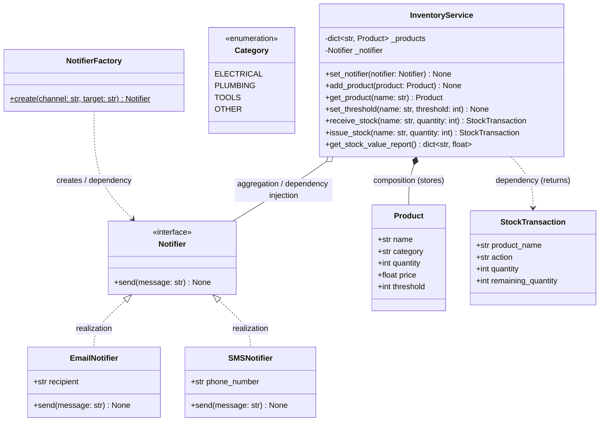
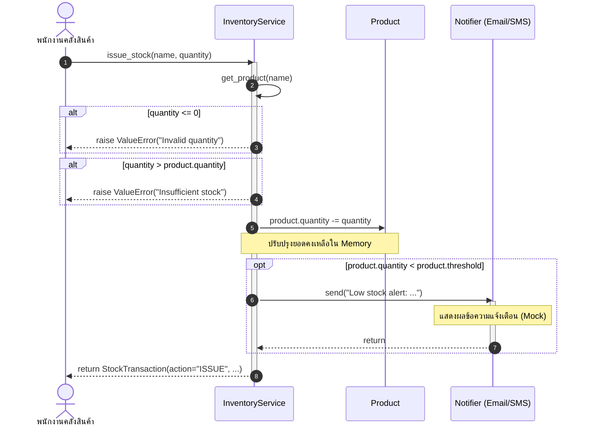

# Class Diagram: Inventory System


````[cite: 19]

---

### 2. ไฟล์ `diagrams/sequence.md`[cite: 19]
1. คลิกขวาที่โฟลเดอร์ **`diagrams`** แล้วเลือก **New File**[cite: 19]
2. ตั้งชื่อไฟล์ว่า **`sequence.md`** (Path: `inventory-sdd/diagrams/sequence.md`)[cite: 19]
3. คัดลอกเนื้อหาบล็อกโค้ด Mermaid ด้านล่างนี้ไปวาง แล้วกดบันทึก (`Ctrl + S`):

````markdown
# Sequence Diagram: จ่ายสินค้าจนสต็อกต่ำกว่า Threshold


````[cite: 19]


